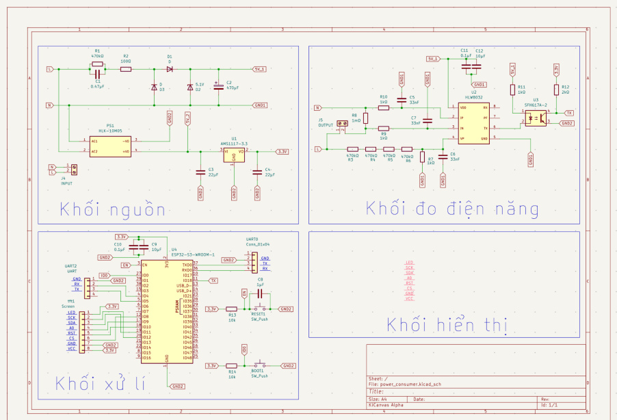
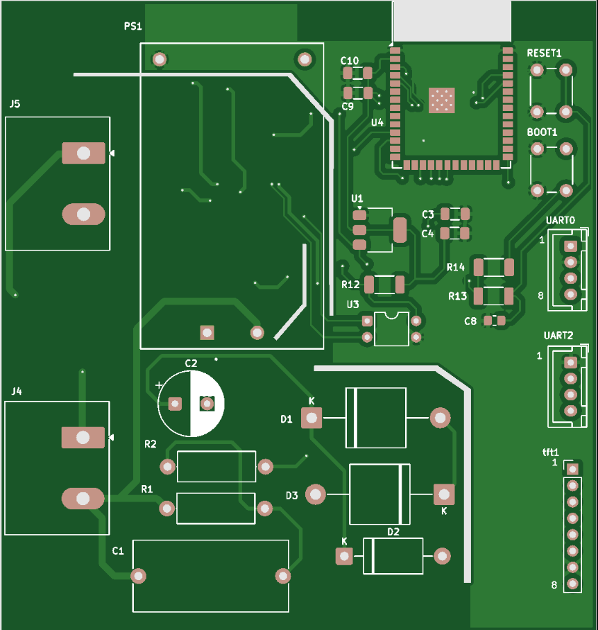
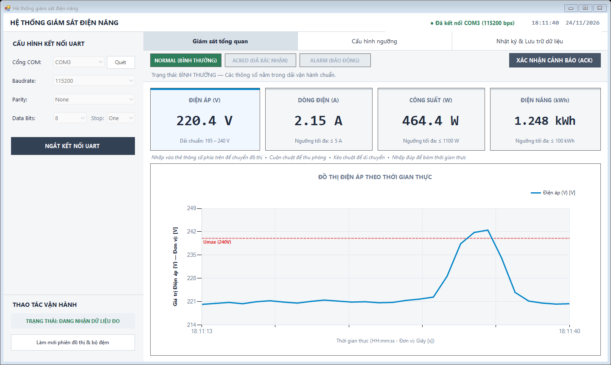
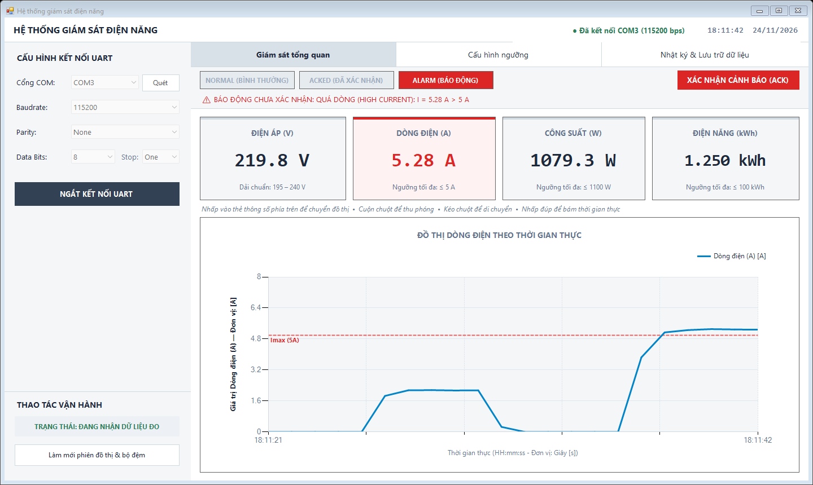
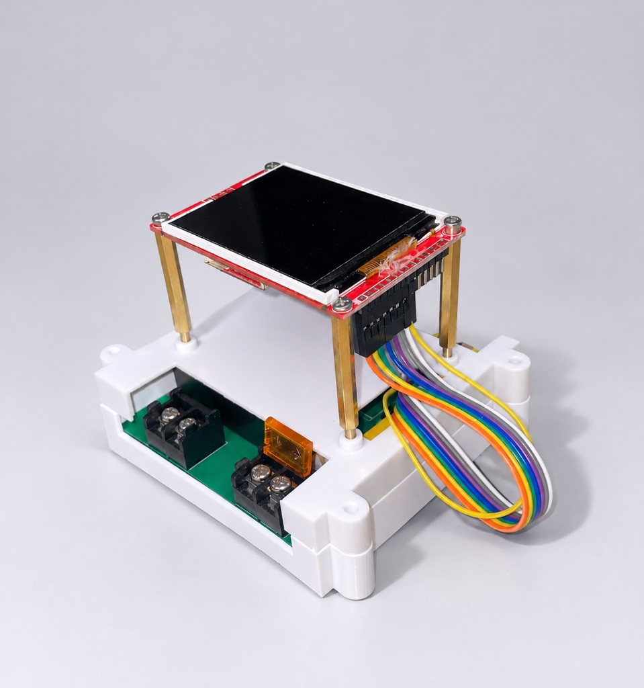

# UDMT - Nhóm 13: Thiết Kế Mạch Đo Điện Năng Tiêu Thụ Của Thiết Bị

- **Trường:** Đại học Công nghệ – ĐHQGHN (UET)
- **Môn học:** Ứng dụng máy tính trong đo lường và điều khiển (`EMA3071E 2`)
- **Giảng viên hướng dẫn:** TS. Hoàng Văn Mạnh
- **Phạm vi đo mục tiêu:** Lưới xoay chiều một pha `85 ÷ 260 VAC (50 Hz)`, dải dòng `0.5 ÷ 10 A` (`100 ÷ 2200 W`, chuyên đo phụ tải công suất vừa và lớn)
- **Phần cứng chính:** IC đo điện năng `HLW8032` + Shunt `1 mΩ` + Opto cách ly quang `SFH617A-2` + Nguồn cách ly `HLK-10M05` + `AMS1117-3.3` + `ESP32-S3-WROOM-1` (`92.40 × 97.90 mm`) + Màn hình TFT **2.8" 240×320**

## Thành viên Nhóm 13
| STT | Họ và Tên | MSSV |
| :-: | :--- | :---: |
| 1 | Vũ Hữu Hoạt | `23021273` |
| 2 | Nguyễn Tuấn Sơn | `23021335` |
| 3 | Nguyễn Văn Thắng | `23021359` |

---

## Cấu trúc kho lưu trữ

```text
UDMT_Nhom13/
├── Hardware_PCB/               # Sơ đồ nguyên lý, mạch in 2 lớp KiCad & file Gerber gia công
│   ├── my_lib.kicad_sym        # Thư viện ký hiệu linh kiện dùng riêng
│   └── power_consumer/         # File .kicad_pro, .kicad_sch, .kicad_pcb và bộ Gerber/Drill
├── 3D_Enclosure_HLW8032/       # Vỏ hộp bảo vệ in 3D (.stl & .scad)
├── Firmware/                   # Mã nguồn nhúng ESP32-S3 (ESP-IDF + LVGL hiển thị TFT & gửi UART)
├── Software_SCADA_HMI/         # Phần mềm giám sát trên PC (C# WinForms .NET Framework 4.7.2)
│   ├── App_ChayNgay/           # Bản Release bấm chạy trực tiếp (BTL_UDMT.exe)
│   ├── SourceCode/             # Mã nguồn đầy đủ mở bằng Visual Studio (BTL_UDMT.sln)
│   └── README.txt              # Hướng dẫn chạy nhanh & kết nối UART
└── docs/images/                # Ảnh minh họa sản phẩm, sơ đồ nguyên lý, PCB và giao diện HMI
```

---

## 1. Phần cứng & Mạch in PCB 2 lớp (`Hardware_PCB/`)

Mạch in 2 lớp kích thước **`92.40 × 97.90 mm`** (dày `1.60 mm`), tách biệt hoàn toàn vùng sơ cấp cao áp `220 VAC (GND1)` và vùng điều khiển thứ cấp `3.3 V (GND2)` bằng nguồn xung cách ly `HLK-10M05` (`3000 VAC`), optocoupler `SFH617A-2` (mắc đồng pha nối vào `IO18`) và các rãnh phay khe hở không khí trên PCB:

- **Kênh áp (`VP`):** Cầu phân áp `4 × 470 kΩ` / `1 kΩ` + tụ lọc `33 nF` ($K_v = 1.88$).
- **Kênh dòng (`IP, IN`):** Điện trở shunt `1 mΩ` (`SMD 2512`) mắc trên dây trung tính + lọc RC `1 kΩ / 33 nF` ($K_i = 1.0$).
- **File gia công:** Đầy đủ bộ file KiCad (`power_consumer.kicad_sch`, `power_consumer.kicad_pcb`) và Gerber/Drill (`*.gtl`, `*.gbl`, `*.gts`, `*.gbs`, `*.gto`, `*.gbo`, `*.gm1`, `*.drl`).

<p align="center">
  
  
</p>

---

## 2. Phần mềm giám sát PC SCADA HMI (`Software_SCADA_HMI/`)

Phần mềm viết bằng **C# WinForms (.NET Framework 4.7.2)** theo chuẩn giao diện công nghiệp **ANSI/ISA-101** (nền trung tính, màu đỏ dành riêng cho báo động) và quản lý cảnh báo 4 trạng thái **ANSI/ISA-18.2** (`NORMAL` → `UNACK ALARM` → `ACKED ACTIVE` → `CLEARED`).

- **Chạy ngay không cần cài đặt:** Mở thư mục `Software_SCADA_HMI/App_ChayNgay/` và nhấp đúp **`BTL_UDMT.exe`**.
- **Giao tiếp 1 chiều từ ESP32-S3 lên PC:** Nhận chuỗi ASCII qua `UART0` (`115200 bps, 8N1`) theo định dạng `DATA,<U>,<I>,<P>,<CosPhi>,<kWh>\n` (chu kỳ `500 ms`), không gửi lệnh ngược xuống mạch.
- **Bố cục 3 Tab đồng bộ tiếng Việt:**
  1. **Giám sát tổng quan:** Hiển thị đồng thời 4 thẻ thông số (`Điện áp V`, `Dòng điện A`, `Công suất W`, `Điện năng kWh`) kèm 1 đồ thị thời gian thực rộng toàn chiều ngang (bấm vào thẻ để chuyển kênh đồ thị, khóa trục tung không âm, hiển thị đường ngưỡng `StripLines`, hỗ trợ Zoom/Pan mượt).
  2. **Cấu hình ngưỡng:** Cài đặt tập trung toàn bộ 5 ngưỡng bảo vệ cục bộ trên PC (`Umin`, `Umax`, `Imax`, `Pmax`, `Emax`).
  3. **Nhật ký & Lưu trữ dữ liệu:** Bảng log thông số thời gian thực, bảng nhật ký sự kiện cảnh báo đến mili-giây (`HH:mm:ss.fff`), **Watchdog 3.5 giây** phát hiện mất kết nối UART và xuất tệp **CSV**.

<p align="center">
  
  
</p>

---

## 3. Firmware nhúng ESP32-S3 (`Firmware/`)

Mã nguồn nhúng trong `Firmware/electrical_meansurement/` xây dựng cho **ESP32-S3-WROOM-1**, đọc khung dữ liệu 24 byte từ `HLW8032` (`UART1`, `4800 bps 8E1`, chu kỳ `50 ms`), kiểm tra Checksum, hiển thị giao diện đồ họa LVGL lên màn hình màu TFT `2.8"` (SPI) và truyền chuỗi dữ liệu đo lên máy tính qua `UART0` (`115200 bps 8N1`).

---

## 4. Vỏ hộp bảo vệ in 3D (`3D_Enclosure_HLW8032/`) & Sản phẩm thực tế

Thiết kế vỏ hộp 3D khóa bằng **4 ốc vít M3 ở 4 tai góc** (tỷ lệ in thành công 100%, không dùng ngàm dễ gãy):
- `1_Enclosure_Bottom_Case.stl` — Đáy hộp (gờ bậc thang đỡ PCB cao `5.5 mm`, 4 tai bắt ốc M3 trước/sau, mở hở toàn khoang đấu dây `J4/J5` trái & `TFT1/UART0/UART2/RESET1/BOOT1` phải).
- `2_Enclosure_Top_Cover.stl` — Nắp hộp trên (4 tai bắt ốc M3 đồng tâm, 4 trụ đè giữ chặt 4 góc PCB, **đục sẵn 4 trụ bắt vít M2.5/M3 tâm `44.6 × 76.0 mm` cao `3.5 mm`** + khe luồn cáp màn hình `2.8"`).
- `4_Full_Assembly_Preview.stl` — Bản ghép tổng thể Đáy + Nắp để kiểm tra trước khi in.
- `5_Enclosure_Parametric.scad` — File nguồn tham số OpenSCAD.

### Thông số in 3D & Lắp ráp khuyến nghị
- **Nhựa:** PLA+ hoặc PETG | **Layer Height:** `0.20 mm` (Nozzle `0.4 mm`) | **Infill:** `15% – 20%` (Grid / Gyroid)
- **Ốc vít lắp ráp:** 4 bu-lông `M3 × 35 mm` hoặc `M3 × 40 mm` + 4 đai ốc M3 cho vỏ hộp; 4 trụ đồng / vít `M2.5–M3` gá màn hình `2.8"`.
- **Khối lượng ước tính:** ~`57 – 60 gram` cho cả bộ Đáy + Nắp.

<p align="center">
  
</p>
